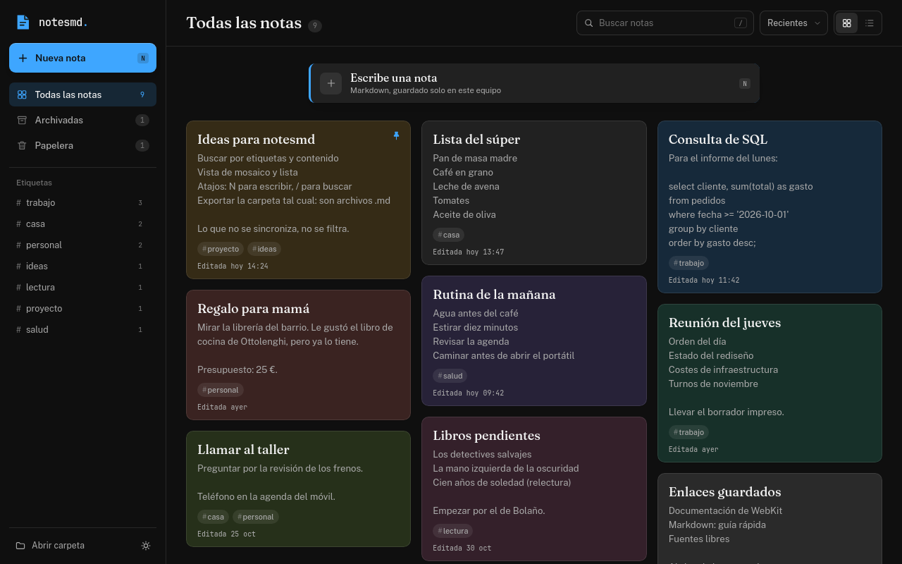
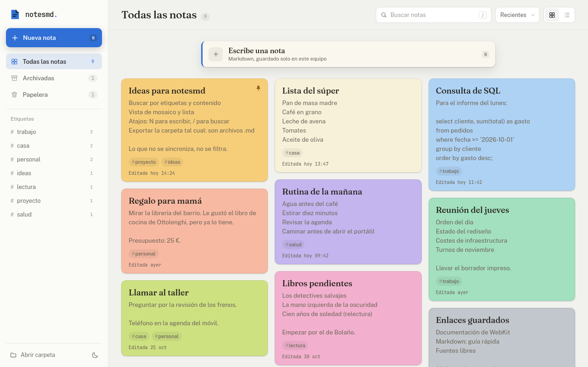
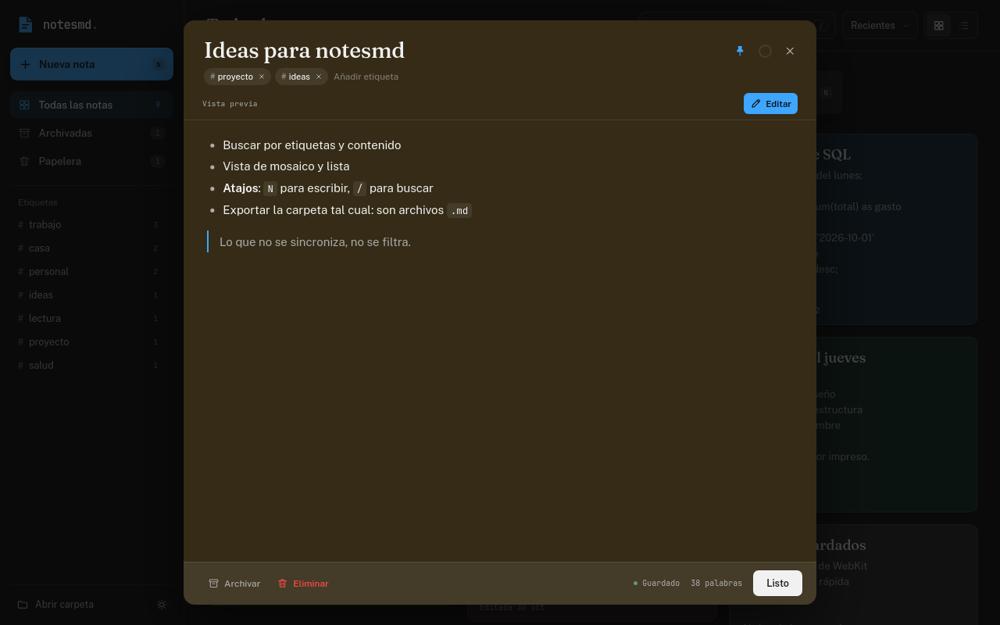

# notesmd

Quick notes for the Linux desktop, in Markdown and without the cloud. A local take on Google Keep: a masonry board of cards, labels, search, pinned notes, archive and trash.

Every note is a real `.md` file inside `~/Notas-notesmd`: open it with Obsidian, edit it by hand, or copy the folder as a backup. No accounts, no servers, no telemetry. The interface is in Spanish.



## Features

- Masonry or list layout, with nine paper colors (light and dark variants).
- Markdown editor with preview: bold, lists, tasks, quotes, code and links.
- Labels (`#work`, `#home`) that filter the board.
- Instant search across title, body and labels.
- Pinned, archived and trashed notes, with undo.
- Autosave (and `Ctrl+S` to force it).
- YouTube-style dark theme (`#0f0f0f` background, `#212121` cards) and a light theme.
- Keyboard shortcuts: `N` for a new note, `/` to search, `Esc` to close.

## Screenshots

| Light theme | Editor with preview |
| --- | --- |
|  |  |

## Install

You need Linux with Python 3, GTK and WebKit2GTK. On Linux Mint / Ubuntu:

```bash
sudo apt install python3-venv python3-gi gir1.2-webkit2-4.1
```

Then, from this folder:

```bash
./install.sh
```

The installer creates an isolated Python environment, registers the app in the
application menu and leaves the `notesmd` command in `~/.local/bin` (if that
folder is not on your `PATH`, add it).

To run it without installing:

```bash
./run.sh
```

## Versions and downloads

The version lives in a single line of `app.py`:

```python
VERSION = "0.1.0"
```

The project follows semver: `MAJOR.MINOR.PATCH` (breaking change / new features /
fixes). The Git tag is prefixed with `v` and **must match**: `v0.1.0`.

To publish a release:

```bash
# 1. bump VERSION in app.py and note the changes in CHANGELOG.md
git add -A
git commit -m "notesmd 0.1.0"
git tag -a v0.1.0 -m "notesmd 0.1.0"
git push origin main --tags
```

Pushing the tag makes `.github/workflows/release.yml` build the packages and
create the Release with them attached. The repository sidebar then shows
**Releases → Latest v0.1.0** with the installer to download.

You can also build the packages locally:

```bash
./scripts/package.sh          # dist/notesmd-0.1.0.tar.gz and dist/notesmd_0.1.0_all.deb
```

- **`.deb`** (recommended): `sudo apt install ./notesmd_0.1.0_all.deb`. It installs
  into `/usr/lib/notesmd`, adds `notesmd` to the menu and declares the GTK/WebKit
  dependencies.
- **`.tar.gz`**: unpack and run `./install.sh` (per-user install, no sudo).

The first Release has to be created by publishing the tag; from then on GitHub
always shows the latest one in that part of the repository.

## Usage

- `N` or the **New note** button to start writing.
- `/` focuses the search box; `Esc` clears it or closes the editor.
- `Ctrl+S` saves immediately (otherwise it autosaves after ~650 ms).
- Hover a card to pin it with the pin button.
- Labels are written inside a note as `#label` and show up in the sidebar.

## Your notes

By default they live in `~/Notas-notesmd` (you can change it with `--data-dir` or
the `NOTESMD_DIR` environment variable). The first run creates a welcome note.

```
~/Notas-notesmd/
├── ideas-para-notesmd-a1b2c3d4.md
├── lista-del-super-9f8e7d6c.md
└── ...
```

Each file has front matter with the card metadata and the rest is plain Markdown:

```markdown
---
id: a1b2c3d4
title: "Ideas para notesmd"
color: ambar
pinned: true
archived: false
trashed: false
created: 2026-10-28T08:12:00
updated: 2026-10-28T08:26:00
tags:
  - proyecto
  - ideas
---

The note body, in Markdown.
```

## Project layout

```
notesmd/
├── app.py                 # window + API exposed to JavaScript
├── backend/store.py       # Markdown store
├── web/
│   ├── index.html
│   ├── css/app.css
│   ├── js/app.js
│   ├── js/vendor/         # marked + DOMPurify
│   └── fonts/             # Fraunces + Public Sans
├── assets/                # icons
├── docs/                  # screenshots used by this README
├── scripts/package.sh     # .tar.gz and .deb for releases
├── .github/workflows/     # automatic release on tag push
├── tests/
├── run.sh
├── install.sh
└── uninstall.sh
```

## Development

The interface runs on its own in a browser with demo data:

```bash
python3 -m http.server 8765 --directory web
# open http://127.0.0.1:8765/
```

For a smoke test of the real window and the Python bridge:

```bash
.venv/bin/python tests/ui_smoke.py
```

## If the window flickers

The board is laid out in flex columns from JavaScript, not with CSS `columns`:
WebKitGTK repaints the multicolumn layout in a loop and the cards flicker. On top
of that, `run.sh` disables WebKit's DMABUF renderer, which causes flicker on some
GPUs (NVIDIA/AMD).

If you still notice it on your machine, start the app with WebKit's compositor
disabled:

```bash
WEBKIT_DISABLE_COMPOSITING_MODE=1 ./run.sh
```
